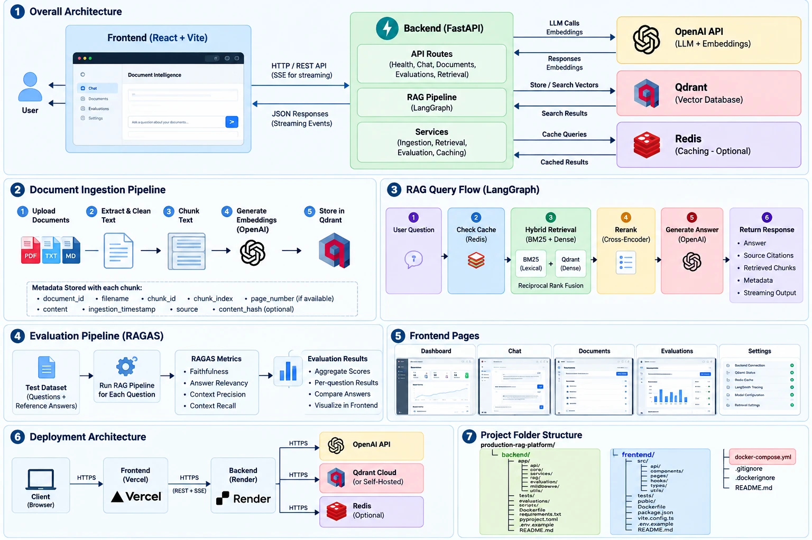
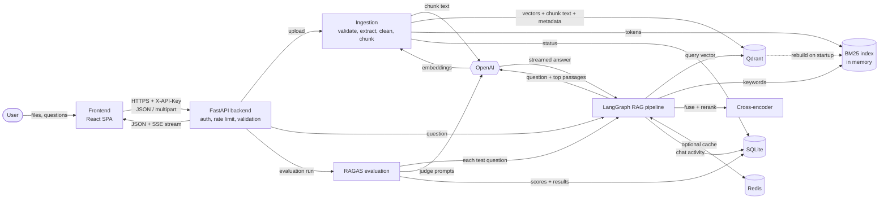

# Production RAG Platform

A document-intelligence platform: upload PDF/TXT/Markdown, ask questions, and get **grounded,
cited answers** streamed to the browser. Retrieval is **hybrid** (dense vectors in Qdrant +
BM25, fused with Reciprocal Rank Fusion), candidates are **reranked by a cross-encoder**, the
workflow is orchestrated with **LangGraph**, and quality is measured with **RAGAS**.

The frontend (React/Vite) and backend (FastAPI) are fully separate applications with their own
dependencies, Dockerfiles and deployment targets.

---

## Contents
1. [Architecture](#architecture) · [Data flow](#data-flow) · [How it works](#how-it-works) · 2. [Features](#features) · 3. [Tech stack](#technology-stack)
4. [Prerequisites](#prerequisites) · 5. [Installation (Windows PowerShell)](#installation-windows-powershell)
6. [Environment variables](#environment-variables) · 7. [OpenAI setup](#openai-api-setup)
8. [Qdrant](#local-qdrant-setup) · 9. [Redis](#optional-redis-setup) · 10. [LangSmith](#optional-langsmith-setup)
11. [Backend startup](#backend-startup) · 12. [Frontend startup](#frontend-startup) · 13. [Docker Compose](#docker-compose-startup)
14. [API reference](#api-endpoints) · 15. [Example requests](#example-api-requests)
16. [Ingestion workflow](#document-ingestion-workflow) · 17. [Retrieval workflow](#rag-retrieval-workflow)
18. [Evaluation workflow](#ragas-evaluation-workflow) · 19. [Testing](#testing) · 20. [Troubleshooting](#troubleshooting)
21. [Deployment](#deployment) · 22. [Security](#security-considerations) · 23. [Limitations](#known-limitations) · 24. [Future work](#future-improvements)

---

## Architecture



Request flow in detail:

```
┌──────────────────────────┐   HTTPS + X-API-Key    ┌──────────────────────────────────────────────┐
│ Frontend (React + Vite)  │ ─────────────────────▶ │ Backend (FastAPI, /api/v1)                    │
│ Vercel / nginx container │ ◀── JSON / SSE ─────── │  middleware: request-id · timing · CORS       │
└──────────────────────────┘                        │  routes → services → rag/                     │
                                                    │                                              │
                                                    │  LangGraph RAG workflow                       │
                                                    │  validate → cache? → retrieve(dense‖BM25)     │
                                                    │  → RRF fuse → cross-encoder rerank            │
                                                    │  → context check → generate (stream)          │
                                                    │  → validate citations → finalize              │
                                                    └───┬───────────┬──────────┬──────────┬────────┘
                                                        │           │          │          │
                                              Qdrant (vectors   OpenAI     SQLite      Redis
                                              + chunk payloads) (embed/LLM) (docs, evals, (optional
                                                                            chat log)   answer cache)
```

* **Qdrant is the source of truth for chunks** (vector + text + metadata). The in-memory BM25
  index is rebuilt from Qdrant payloads at startup and kept in sync on add/delete.
* **SQLite** stores the document registry (ingestion status), evaluation runs/results and a
  bounded chat-activity log for the dashboard.
* **LangSmith** (optional) traces each LangGraph run and each OpenAI call.

## Data flow



Detailed diagrams (ingestion, streaming chat sequence, LangGraph nodes, evaluation, deletion,
startup and recovery, what is stored where) and a step-by-step explanation of how each part
works are in **[docs/DATA_FLOW.md](docs/DATA_FLOW.md)**.

## How it works

1. **Upload.** You drop PDF/TXT/Markdown files on the Documents page. The backend checks type,
   content and size, skips exact duplicates, and processes each file in the background.
2. **Index.** Text is extracted (page by page for PDFs), cleaned and split into ~800-character
   chunks with overlap. Each chunk is embedded with OpenAI and stored in Qdrant together with
   its text and source metadata; the BM25 keyword index is updated at the same time. The
   document shows `indexed` only after Qdrant confirms the write.
3. **Ask.** A question is searched two ways at once: by meaning (vector search in Qdrant) and
   by keywords (BM25). The two ranked lists are merged with Reciprocal Rank Fusion, and a
   cross-encoder re-scores the best candidates to keep the 4 most relevant chunks.
4. **Answer.** If nothing relevant was found, the app says so without calling the model.
   Otherwise the model receives the question plus the numbered chunks, with instructions to
   answer only from them and cite them as `[1]`, `[2]`. The answer streams to the browser
   token by token; the sources panel fills in before the first token.
5. **Verify citations.** Every `[n]` in the answer is checked against the chunks that were
   actually retrieved; invalid markers are removed and each citation shows filename, page
   (when known) and an excerpt.
6. **Measure.** The Evaluations page runs a dataset of questions with reference answers through
   the same pipeline and scores faithfulness, answer relevancy, context precision and context
   recall with RAGAS, saving per-question results for inspection and export.

## Features

| Area | What is implemented |
|---|---|
| Ingestion | Multi-file upload, extension allow-list + magic-byte/UTF-8 checks, streamed-to-disk size limit, SHA-256 duplicate detection, page-aware PDF extraction, scanned-PDF detection ("OCR not configured"), cleaning, configurable recursive chunking, batched embeddings, confirmed Qdrant writes, per-file outcomes, background jobs with status, retry by re-upload, deletion of document + vectors |
| Retrieval | Dense (Qdrant cosine) + real BM25 (Okapi, Lucene IDF), Reciprocal Rank Fusion, chunk-id dedup, document filters, retrieval inspector endpoint/UI |
| Reranking | `cross-encoder/ms-marco-MiniLM-L-6-v2` loaded once (lazy or preloaded), explicit `error`/`fusion` fallback policy, never silently claims reranking |
| Generation | Grounded prompt, untrusted-context delimiting, prompt-injection rules, `[n]` citations validated against retrieved chunks, invalid markers stripped, insufficient-context short-circuit (no LLM call when nothing is retrieved) |
| Streaming | SSE events `start`, `sources`, `token`, `metadata`, `error`, `done`; disconnect stops generation |
| Evaluation | RAGAS 0.4 faithfulness, answer relevancy, context precision, context recall; background runs persisted per case; 35-case sample dataset + corpus; JSON/CSV export |
| Ops | Pydantic-validated config, structured JSON logs with request IDs and secret redaction, consistent error bodies, health/readiness, rate limiting, optional Redis cache, optional LangSmith |
| Frontend | Dashboard, streaming chat with sources panel, documents (drag-drop, progress, status polling, delete confirm), evaluations (charts, per-question drill-down), settings; dark/light; responsive |

## Technology stack

**Backend:** Python 3.11 · FastAPI 0.148 · Uvicorn · Pydantic 2 / pydantic-settings · LangGraph 1.2 ·
langchain-text-splitters · OpenAI SDK 3.3 · Qdrant client 1.19 · sentence-transformers 6.1 (CPU torch) ·
RAGAS 0.4.3 · LangSmith · Redis (optional) · pypdf · pytest · Ruff.

**Frontend:** React 19 · Vite 8 · TypeScript 6 · Tailwind CSS 4 · React Router 8 · TanStack Query 5 ·
lucide-react · Recharts 3 · react-markdown (raw HTML disabled) · Vitest 5 + Testing Library.

**Infra:** Docker, Docker Compose, Qdrant, Redis (profile), Render (backend), Vercel (frontend).

Dependency notes (all versions in `backend/requirements.txt` were installed and tested together):
* `ragas==0.4.3` depends on `instructor`, and `instructor 1.17` caps `openai` at 3.3.x, so the
  OpenAI SDK is pinned to `3.3.0`.
* `ragas 0.4.3` imports `langchain_community.chat_models.vertexai`, which was removed in
  `langchain-community 0.4.2`; it is pinned to `0.4.1`.
* PyTorch is installed from the CPU wheel index to avoid multi-GB CUDA builds.

## Prerequisites

* **Python 3.11** (3.11–3.13 supported by the dependency set; tested on 3.11.9)
* **Node.js 20+** (tested on 24.9) and npm
* **Docker Desktop** (optional; for Qdrant/Redis/full stack). Verify:
  ```powershell
  docker --version
  docker compose version
  docker info   # fails if the Docker daemon is not running – start Docker Desktop
  ```
* An **OpenAI API key** with billing enabled for ingestion, chat and evaluation.
* ~8 GB RAM is enough: the reranker uses roughly 200–400 MB; large documents and evaluation
  runs add more.

## Installation (Windows PowerShell)

```powershell
git clone <your-repo-url> production-rag-platform
cd production-rag-platform

# Backend
cd backend
py -3.11 -m venv .venv
.\.venv\Scripts\Activate.ps1
pip install -r requirements-dev.txt      # runtime + test/lint tools (requirements.txt = runtime only)
Copy-Item .env.example .env              # then edit .env and set OPENAI_API_KEY
cd ..

# Frontend
cd frontend
npm install
Copy-Item .env.example .env
cd ..
```

If PowerShell blocks `Activate.ps1`, run once: `Set-ExecutionPolicy -Scope CurrentUser RemoteSigned`.

## Environment variables

Backend (`backend/.env`, template in `backend/.env.example`):

| Variable | Required | Default | Notes |
|---|---|---|---|
| `OPENAI_API_KEY` | **Yes** for ingestion/chat/eval (enforced at startup in production) | – | Server-side only |
| `OPENAI_MODEL` | No | `gpt-4o-mini` | Verify your account has access; no silent model fallback |
| `OPENAI_EMBEDDING_MODEL` | No | `text-embedding-3-small` | Changing it requires a reindex |
| `EMBEDDING_DIMENSIONS` | Only for unknown models | native size | |
| `QDRANT_URL` | No | `http://localhost:6333` | `http://qdrant:6333` inside Compose |
| `QDRANT_API_KEY` | Qdrant Cloud only | – | |
| `QDRANT_COLLECTION_NAME` | No | `rag_documents` | |
| `QDRANT_PATH` | No | – | Dev-only embedded Qdrant (no Docker); rejected in production |
| `CHUNK_SIZE` / `CHUNK_OVERLAP` | No | `800` / `120` | Characters; overlap must be < size |
| `RETRIEVAL_TOP_K` / `RERANK_TOP_K` | No | `10` / `4` | rerank ≤ retrieval |
| `RERANKER_ENABLED`, `RERANKER_MODEL`, `RERANKER_FALLBACK`, `RERANKER_PRELOAD` | No | `true`, MiniLM-L-6, `error`, `false` | |
| `LANGSMITH_TRACING` / `LANGSMITH_API_KEY` / `LANGSMITH_PROJECT` | Only when tracing | `false` | Key required if tracing is on |
| `REDIS_URL` / `ENABLE_CACHE` | Only for caching | – / `false` | `ENABLE_CACHE=true` requires `REDIS_URL` |
| `API_KEY` | **Yes** in production | – | Empty = auth disabled (development only, warned in UI) |
| `CORS_ORIGINS` | No | `http://localhost:5173` | Comma-separated, wildcards rejected |
| `MAX_UPLOAD_SIZE_MB` | No | `20` | Per file |
| `LOG_LEVEL` | No | `INFO` | |
| `ENVIRONMENT` | No | `development` | `production` enables strict checks |

Invalid combinations fail at startup with a readable message, e.g.
`Invalid configuration: CHUNK_OVERLAP must be smaller than CHUNK_SIZE`.

Frontend (`frontend/.env`): `VITE_API_BASE_URL=http://localhost:8000/api/v1`. `VITE_*` values
are **public** (compiled into the bundle) – never put secrets there.

## OpenAI API setup

1. Create a key at <https://platform.openai.com/api-keys> and add billing/credits.
2. Put it in `backend/.env` as `OPENAI_API_KEY=...`.
3. **OpenAI API usage is billed separately from any ChatGPT subscription.**

Paid features: ingestion (embeddings), chat (1 embedding + 1 chat completion per question),
retrieval inspector (1 embedding), evaluation (RAG answer + ~10 judge calls per case with all
four metrics). Cost scales with document size, question count and model choice; check current
prices on OpenAI's pricing page. Health checks, listing, deletion and the UI are free.

## Local Qdrant setup

```powershell
docker compose up -d qdrant
# dashboard: http://localhost:6333/dashboard
```
Data persists in the `qdrant_data` Docker volume. Without Docker you can develop with
embedded Qdrant: set `QDRANT_PATH=./data/qdrant` in `backend/.env` (single process only).

## Optional Redis setup

```powershell
docker compose --profile cache up -d redis
```
Then set `ENABLE_CACHE=true` and `REDIS_URL=redis://localhost:6379/0`. Cache keys include the
normalized question, document filter, model names, retrieval parameters and a corpus version
that is bumped on every ingestion/deletion. Redis outages fail open (requests continue uncached,
Redis is skipped for 30 s). Errors, insufficient-context answers and fallback-ranked answers are
never cached. The app works fully without Redis.

## Optional LangSmith setup

```
LANGSMITH_TRACING=true
LANGSMITH_API_KEY=lsv2_...
LANGSMITH_PROJECT=production-rag-platform
LANGSMITH_HIDE_CONTENT=true   # optional: redact questions/documents/answers from traces
```
Each chat creates a LangGraph run (`rag_chat` / `rag_chat_stream`) with one child span per
node, plus OpenAI call spans. When disabled, tracing is forced off. The Settings page shows
whether tracing is active; local latency diagnostics are always visible in the UI.

## Backend startup

```powershell
docker compose up -d qdrant
cd backend
.\.venv\Scripts\Activate.ps1
uvicorn app.main:app --reload --port 8000
```
* Swagger UI: <http://localhost:8000/docs> · ReDoc: <http://localhost:8000/redoc> ·
  OpenAPI JSON: <http://localhost:8000/api/v1/openapi.json>

## Frontend startup

In another terminal:
```powershell
cd frontend
npm run dev        # http://localhost:5173
```
If the backend has `API_KEY` set, paste it on the **Settings** page (stored in this browser only).

## Docker Compose startup

```powershell
Copy-Item backend\.env.example backend\.env   # set OPENAI_API_KEY (and API_KEY if desired)
docker compose up -d --build                   # qdrant + backend + frontend
docker compose --profile cache up -d --build   # ... plus Redis (set ENABLE_CACHE=true)
docker compose ps
docker compose logs -f backend
docker compose down                            # keep data;  add -v to delete volumes
```
* Frontend: <http://localhost:8080> · Backend: <http://localhost:8000/docs>
* Ports are bound to `127.0.0.1` only. The backend container reaches Qdrant at
  `http://qdrant:6333`; the browser reaches the backend at `http://localhost:8000`
  (`VITE_API_BASE_URL` is a build arg).
* Dev vs prod: Compose builds production images (nginx static frontend, uvicorn without reload).
  For hot reload use the non-Docker commands above.

## API endpoints

All under `/api/v1`. Everything except `/health` and `/ready` requires `X-API-Key` when `API_KEY` is set.

| Method | Path | Purpose |
|---|---|---|
| GET | `/health` | Liveness + component status (no secrets) |
| GET | `/ready` | 200 only if Qdrant, BM25 index and OpenAI config are ready, else 503 |
| GET | `/config` | Non-sensitive configuration + warnings |
| GET | `/stats` | Dashboard statistics from real data |
| POST | `/documents/upload` | Multipart `files` (≤10); `?wait=true` blocks until indexed. 202 with per-file outcomes |
| GET | `/documents` | `limit`, `offset`, `status` |
| GET | `/documents/{id}` | Metadata + status |
| DELETE | `/documents/{id}` | Deletes vectors, BM25 entries and record |
| GET | `/ingestion/status/{id}`, `/ingestion/summary` | Status polling helpers |
| POST | `/chat` | `{question, session_id?, document_ids?, include_retrieval?}` → answer + citations |
| POST | `/chat/stream` | Same body, Server-Sent Events |
| POST | `/retrieval/search` | `{query, top_k?, rerank_top_k?, rerank?, document_ids?}` |
| GET | `/evaluations/datasets`, `/evaluations/prerequisites` | Datasets and exact missing prerequisites |
| POST | `/evaluations/run` | `{dataset, limit?, metrics?}` → 202, background run |
| GET | `/evaluations`, `/evaluations/{id}`, `/evaluations/{id}/results` | History, run, per-case results |

Errors always look like `{"error": {"code", "message", "request_id", "details?"}}`.

SSE format (each frame is `event: <name>\ndata: <one-line JSON>\n\n`):
`start {request_id, session_id}` → `sources {chunks, rerank_mode, cache_hit}` → `token {text}`×n →
`metadata <ChatResponse>` (or `error {code, message}`) → `done {}`.

## Example API requests

PowerShell (use `curl.exe`, not the `curl` alias):
```powershell
$H = @{ "X-API-Key" = "your-app-key" }
Invoke-RestMethod http://localhost:8000/api/v1/health
curl.exe -H "X-API-Key: your-app-key" -F "files=@backend/evaluations/sample_corpus/platform_guide.md" "http://localhost:8000/api/v1/documents/upload?wait=true"
Invoke-RestMethod http://localhost:8000/api/v1/documents -Headers $H
Invoke-RestMethod -Method Post http://localhost:8000/api/v1/chat -Headers $H -ContentType "application/json" -Body '{"question":"What is the default chunk size?"}'
curl.exe -N -H "X-API-Key: your-app-key" -H "Content-Type: application/json" -d "{\"question\":\"What is RRF?\"}" http://localhost:8000/api/v1/chat/stream
Invoke-RestMethod -Method Post http://localhost:8000/api/v1/retrieval/search -Headers $H -ContentType "application/json" -Body '{"query":"BM25 parameters"}'
Invoke-RestMethod -Method Delete http://localhost:8000/api/v1/documents/<document_id> -Headers $H
```
bash:
```bash
curl -H "X-API-Key: $KEY" -H "Content-Type: application/json" -d '{"question":"What is RRF?"}' http://localhost:8000/api/v1/chat
```

## Document ingestion workflow

1. Filename sanitized (directory parts stripped, never used as a server path); extension checked.
2. Upload streamed in 1 MB chunks to a server-named temp file while hashing; aborted past the limit.
3. Magic bytes (`%PDF-`) or UTF-8/no-NUL checks.
4. Duplicate check by SHA-256 (indexed/pending/processing → `duplicate`; failed → retried).
5. Record created (`pending`) → background task (`processing`, concurrency 2).
6. Extract (PDF per page; scanned PDFs → "OCR is not configured"), clean, chunk per page.
7. Embed in batches of 64 (SDK retries 429/5xx/timeouts with backoff, bounded).
8. Upsert to Qdrant with `wait=True`; status `indexed` only after Qdrant confirms. On failure
   partial vectors are removed and the record is `failed` with a safe reason.
9. BM25 updated, cache version bumped, temp file deleted.

Chunk payload: `document_id, filename, chunk_id (UUIDv5), chunk_index, page_number (null for
TXT/MD), source, content, content_hash, document_hash, ingestion_timestamp, embedding_model, char_count`.

**Embedding-model changes:** the startup check compares collection vector size to the configured
model. On mismatch the API refuses ingestion/queries (`vector_dimension_mismatch`, readiness 503).
Migrate with `python scripts/reindex.py --source rag_documents --target rag_documents_v2`, then set
`QDRANT_COLLECTION_NAME`. Collections are never altered implicitly.

## RAG retrieval workflow

1. **validate_request** → **check_cache** (if enabled)
2. **retrieve**: query embedding → Qdrant top-k ‖ BM25 top-k (concurrently)
3. **fuse**: RRF `Σ w/(k+rank)`, k=60, dedup by chunk id
4. **rerank**: cross-encoder scores (question, chunk) pairs → top `RERANK_TOP_K`
5. **check_context**: no chunks → fixed insufficient-context answer, no LLM call
6. **generate**: streamed completion with numbered, delimited, untrusted passages
7. **validate_output**: detect model-declared insufficiency, map `[n]` → chunks, strip invalid markers
8. **finalize**: latency totals, cache write (only for valid cited answers)

BM25 limitations: the lexical index lives in each process's memory (~text size of the corpus), is
rebuilt on start (O(chunks)), and is per-worker. Run one worker per instance, or swap
`BM25Index` for Qdrant sparse vectors / OpenSearch / Postgres FTS behind the same `search` API.

## RAGAS evaluation workflow

1. Index the sample corpus: upload `backend/evaluations/sample_corpus/platform_guide.md`
   (or `python scripts/ingest_sample_corpus.py`).
2. Evaluations page → choose dataset and optional case limit → **Run evaluation**
   (or `python scripts/run_evaluation.py --limit 5`).
3. Each case runs the real pipeline (cache bypassed), then RAGAS scores it; results are saved
   after every case. Negative cases (`expect_insufficient`) get a non-RAGAS `abstention` check.

Dataset format: JSONL with `id, question, reference_answer, reference_contexts, metadata`
(see `backend/evaluations/sample_dataset.jsonl`, 35 cases). Runs are stored in SQLite; a run
interrupted by restart is marked `interrupted` (in-process jobs are not durable). **LLM-judged
metrics incur OpenAI charges.** No scores are ever shown that were not computed.

## Testing

Backend (from `backend/`, venv active):
```powershell
pytest                 # unit + API tests (fakes for OpenAI; in-memory Qdrant) – no network, no cost
pytest -m slow         # real cross-encoder (downloads ~90 MB once)
pytest -m openai       # live OpenAI test (requires OPENAI_API_KEY; small cost)
ruff check . ; ruff format --check .
python scripts/smoke_test.py --base-url http://localhost:8000/api/v1   # E2E against a running stack
```
Frontend (from `frontend/`):
```powershell
npm test ; npm run lint ; npm run typecheck ; npm run build
```

## Troubleshooting

| Symptom | Fix |
|---|---|
| `ready` 503, openai `not_configured` | Set `OPENAI_API_KEY` in `backend/.env`, restart |
| `upstream_auth_error` | Invalid/revoked key |
| `upstream_quota_exceeded` | Add billing/credits to the OpenAI project |
| `upstream_rate_limited` | Wait, lower `INGESTION_CONCURRENCY`/`EMBEDDING_BATCH_SIZE` |
| Qdrant `down` | `docker compose up -d qdrant`; inside Compose use `http://qdrant:6333`, not localhost |
| `vector_dimension_mismatch` | Embedding model changed – run `scripts/reindex.py` |
| `reranker_unavailable` | First run needs internet to download the model; or `RERANKER_FALLBACK=fusion` |
| Browser "CORS policy" errors | Add the exact frontend origin to `CORS_ORIGINS` |
| 401 in UI | Paste `API_KEY` on the Settings page |
| `docker info` fails | Start Docker Desktop |
| Scanned PDF fails | OCR is not configured; export text or add OCR |

## Deployment

**Full step-by-step guide (Qdrant Cloud database, Render, Vercel, Redis, LangSmith,
verification, troubleshooting): [docs/DEPLOYMENT.md](docs/DEPLOYMENT.md).** Summary:

**Backend → Render** (`render.yaml` blueprint provided):
1. New → Blueprint → select the repo (or a Docker web service with root `backend/`).
2. Set secrets: `OPENAI_API_KEY`, `API_KEY`, `QDRANT_URL` + `QDRANT_API_KEY` (use **Qdrant Cloud** –
   the Render filesystem is ephemeral and must not hold vectors), `CORS_ORIGINS=https://<your-app>.vercel.app`.
3. Health check path `/api/v1/health`. Start command is the Dockerfile `CMD` (honours `$PORT`).
4. The blueprint mounts a 1 GB persistent disk at `/app/data` for SQLite metadata and the model cache;
   without a disk, document/evaluation history resets on each deploy (vectors in Qdrant Cloud persist).
5. The blueprint uses the `1c-2g` plan (2 GB RAM) for PyTorch and the cross-encoder; disks need a
   paid instance. Render terminates TLS (HTTPS).
6. Optional: `REDIS_URL` to a reachable Redis (e.g. Render Key Value) and `ENABLE_CACHE=true`.

**Frontend → Vercel** (`frontend/vercel.json` provided):
1. Import the repo, set **Root Directory** = `frontend`, framework Vite.
2. Env var `VITE_API_BASE_URL=https://<your-backend>.onrender.com/api/v1` (rebuild after changes).
3. SPA fallback is handled by the rewrite in `vercel.json`.
4. Put the Vercel origin into the backend's `CORS_ORIGINS` (exact scheme + host, no trailing slash).

Both deploy independently; nothing in this repo has been deployed by the author of these
instructions – verify each step in your own accounts.

## Security considerations

* OpenAI/Qdrant/LangSmith keys live only in backend env vars; never in the frontend bundle.
* Single shared application key (`X-API-Key`, constant-time compare). The browser stores it in
  localStorage when the user enters it – acceptable for a **single-user portfolio deployment**, not
  for multi-user production. A real multi-user system needs OIDC/OAuth sessions, per-user document
  ownership and ACL filters in retrieval, per-tenant cache scopes (the cache already supports a
  `scope`), audit logging and key rotation.
* Uploads: allow-list, magic-byte checks, size limits, sanitized names, server-generated temp paths,
  content never executed. Retrieved text is treated as untrusted data in the prompt; model output is
  rendered as Markdown with raw HTML disabled and images/unsafe links stripped.
* CORS: explicit origins only, no credentials. Rate limiting on expensive endpoints (in-process;
  use a gateway or shared store across instances). Logs redact keys/authorization values; stack
  traces are never returned to clients. Serve everything over HTTPS in deployment.
* This is not an audited, enterprise-secure system; it implements the controls listed above only.

## Known limitations

* No OCR for scanned PDFs.
* Ingestion and evaluation jobs are in-process (not durable across restarts; marked failed/interrupted).
* BM25 index is in memory and per-process; run a single worker per instance.
* SQLite metadata suits a single instance; use Postgres for horizontal scaling.
* Rate limiting is per process.
* Chat sessions group activity but the pipeline does not use conversation history (each question is
  answered independently).
* End-to-end tests with real OpenAI calls were not executed in the development environment used to
  build this project (no API key was available) – run `pytest -m openai` and `scripts/smoke_test.py`.

## Future improvements

Persistent lexical index (Qdrant sparse/BM42), durable job queue (Arq/Celery), multi-user auth and
per-user ACLs, conversational query rewriting with history, OCR (Tesseract/Azure DI), semantic
cache, streaming evaluation progress, Postgres metadata, OpenTelemetry metrics.

## Repository layout

```
production-rag-platform/
├── backend/   FastAPI app (app/), tests/, evaluations/ (dataset + corpus), scripts/, Dockerfile
├── frontend/  React app (src/), tests/, Dockerfile, nginx.conf, vercel.json
├── docker-compose.yml   render.yaml   .gitignore   .dockerignore   README.md
```
