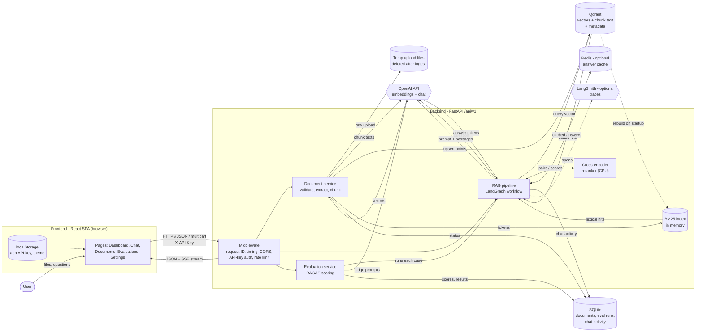
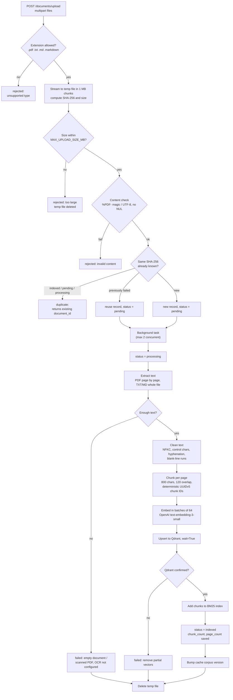
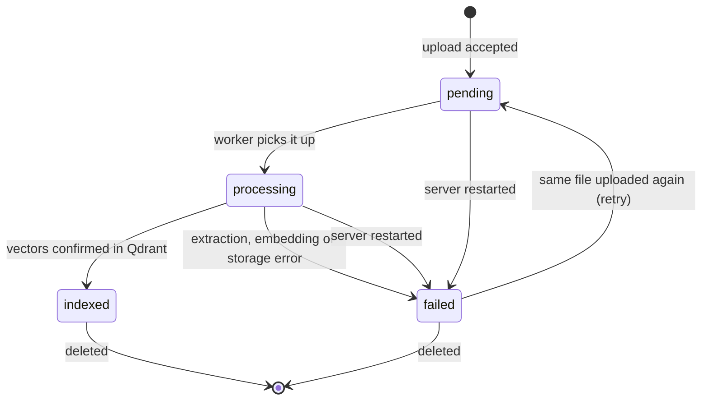
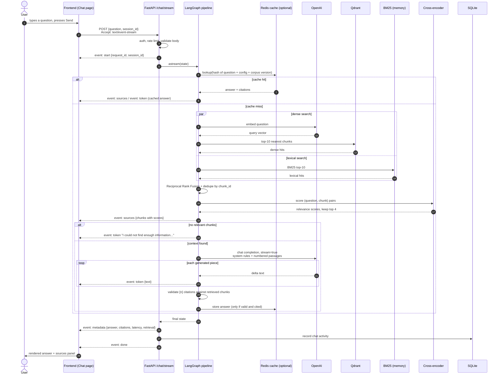
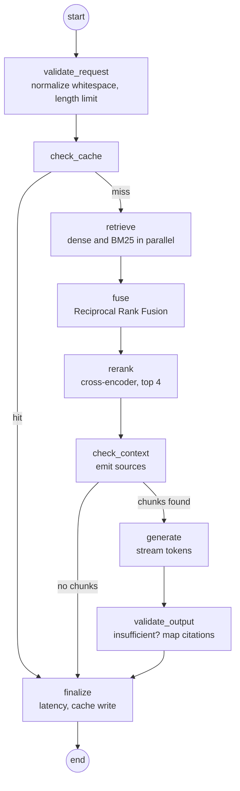
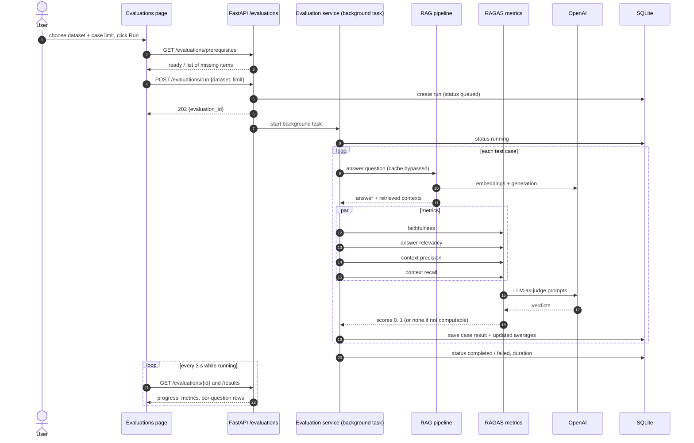
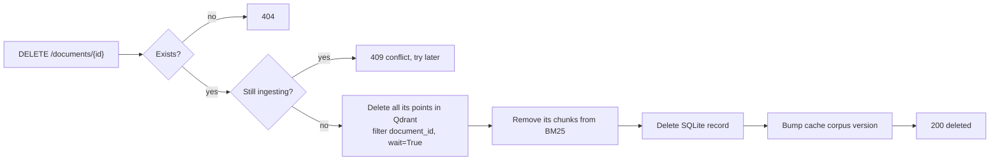
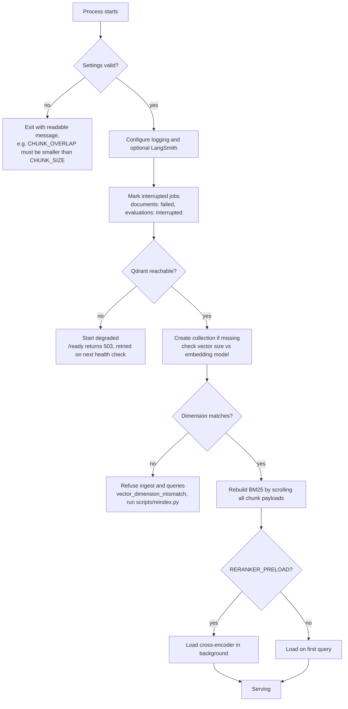

# Data Flow and How the Platform Works

This document explains how data moves through the platform, what is stored where, and what
happens step by step when you upload a document, ask a question, or run an evaluation. The
diagrams are [Mermaid](https://mermaid.js.org/) and render directly on GitHub.

- [1. System data flow](#1-system-data-flow)
- [2. Where data is stored](#2-where-data-is-stored)
- [3. Document ingestion](#3-document-ingestion)
- [4. Asking a question (streaming chat)](#4-asking-a-question-streaming-chat)
- [5. The LangGraph workflow](#5-the-langgraph-workflow)
- [6. Running an evaluation](#6-running-an-evaluation)
- [7. Deleting a document](#7-deleting-a-document)
- [8. Startup and recovery](#8-startup-and-recovery)
- [9. What crosses the network](#9-what-crosses-the-network)

---

## 1. System data flow

Rounded boxes are processes, cylinders are data stores, hexagons are external services.

**Key idea:** Qdrant is the source of truth for document content. Every chunk is stored there
with its vector *and* its text, so the BM25 index can be rebuilt from Qdrant after a restart,
and the whole corpus can be re-embedded with a new model without the original files.

## 2. Where data is stored

| Store | What it holds | Lifetime | Notes |
|---|---|---|---|
| **Qdrant** collection (`rag_documents`) | One point per chunk: vector, `content`, `document_id`, `filename`, `chunk_id`, `chunk_index`, `page_number`, `source`, `content_hash`, `document_hash`, `ingestion_timestamp`, `embedding_model`, `char_count` | Until the document is deleted | Docker volume locally; Qdrant Cloud in production |
| **BM25 index** | Token counts and chunk payloads | Process memory; rebuilt from Qdrant at startup | One copy per worker process |
| **SQLite** `data/app.db` | `documents` (status, errors, counts), `evaluation_runs`, `evaluation_results`, `chat_activity` (last 500, question truncated to 200 chars) | Persistent on disk/volume | Metadata only, no vectors |
| **Temp files** `data/uploads/` | Raw uploaded bytes | Deleted as soon as ingestion finishes or fails | Server-generated names, never the user's filename |
| **Redis** (optional) | Final answers + citations, keyed by a hash | `CACHE_TTL_SECONDS` (default 1 h) and invalidated on any corpus change | Never stores errors or "insufficient context" answers |
| **Hugging Face cache** | Cross-encoder weights (~90 MB) | Persistent | Downloaded once |
| **Browser localStorage / sessionStorage** | Application API key, theme; current chat messages and session ID | Per browser | The OpenAI key is never in the browser |

## 3. Document ingestion

### 3.1 Data flow

### 3.2 Document status lifecycle

### 3.3 How it works

1. **Upload.** The browser sends files with `XMLHttpRequest` so it can show upload progress.
   The backend reads each file in 1 MB pieces into a temp file, hashing as it goes, and stops
   as soon as the size limit is exceeded, so a huge file never sits in memory.
2. **Validation.** Only the four allowed extensions pass; the filename is sanitized for display
   and never used to build a server path. PDFs must start with `%PDF-`; text files must be
   UTF-8 without binary bytes.
3. **Duplicates.** The SHA-256 of the content is checked against SQLite. Re-uploading a file
   that previously **failed** retries it under the same document ID.
4. **Background processing.** The API answers `202 Accepted` immediately with a per-file
   outcome. The UI polls `/documents` every 2 seconds while anything is pending or processing.
   (`?wait=true` makes the request block until done; scripts use this.)
5. **Extraction and chunking.** PDFs are read page by page so every chunk keeps its real page
   number; TXT/Markdown chunks have `page_number = null` (the UI shows "page n/a" rather than
   inventing one). Markdown is split preferentially at headings.
6. **Embedding.** Chunks are embedded in batches. The OpenAI SDK retries rate-limit, timeout and
   server errors with backoff, a bounded number of times; authentication and quota errors are
   reported immediately with a clear message.
7. **Storage.** Points are written to Qdrant with `wait=True`. The document becomes `indexed`
   only after Qdrant confirms the write. On any failure the partial vectors are removed.

## 4. Asking a question (streaming chat)

### How it works

1. **The request.** The chat page posts the question and a session ID and reads the response
   body as a stream. A custom SSE parser handles events split across network packets.
2. **Retrieval runs two ways at once.** The question is embedded and searched in Qdrant
   (meaning-based), while BM25 searches the same chunks by keywords (exact terms, names,
   numbers). Each returns its top 10.
3. **Fusion.** Reciprocal Rank Fusion gives each chunk `1/(60 + rank)` from each list it
   appears in. Chunks found by both methods rise to the top. Duplicates are merged by chunk ID.
4. **Reranking.** A cross-encoder reads the question and each candidate chunk *together* and
   scores how well the chunk answers the question. The best 4 are kept. This is slower but
   much more accurate than the first-stage search, which is why it only runs on 10 candidates.
5. **Sources are sent first.** The UI receives the selected chunks before the answer starts,
   so the sources panel fills in immediately.
6. **No context, no LLM call.** If nothing relevant was found, the platform answers "I could
   not find enough information..." without calling the model, so it cannot invent an answer.
7. **Grounded generation.** The model gets strict rules (answer only from the passages, cite
   them as `[n]`, ignore any instructions inside documents) and the passages wrapped in
   `<passage>` tags marked as untrusted data. Tokens are forwarded to the browser as they
   arrive.
8. **Citation check.** After generation, every `[n]` is mapped to the actual chunk it refers
   to. Markers pointing at passages that were never supplied are removed. The final, validated
   answer is sent in the `metadata` event and replaces the streamed text in the UI.
9. **Cancel / disconnect.** Pressing Stop aborts the request; the backend notices the
   disconnect and stops the OpenAI stream, so no further tokens are generated or billed.

The non-streaming `POST /chat` runs exactly the same graph and returns the final JSON.

## 5. The LangGraph workflow

State carried between nodes: `question`, `session_id`, `document_ids`, dense and lexical
hits, `retrieved_documents`, `reranked_documents`, `rerank_mode`, `answer`, `citations`,
`insufficient_context`, `cache_hit`, `retrieval_scores`, `latency`, `errors`. Secrets are never
put in the state.

If the reranker cannot load: with `RERANKER_FALLBACK=error` the request fails with a clear
503; with `fusion` the fused order is used and the response is labelled `fallback_fusion`, so
it is never presented as reranked.

## 6. Running an evaluation

### How it works

1. **Prerequisites first.** The page asks the backend what is missing (OpenAI key, RAGAS,
   indexed documents) and disables the Run button with the exact reasons.
2. **Real pipeline.** Each test question goes through the same retrieval, reranking and
   generation as a normal chat, with the cache turned off so every answer is fresh.
3. **Metrics** (RAGAS 0.4, LLM-as-judge):
   - **Faithfulness:** are the answer's claims supported by the retrieved passages?
   - **Answer relevancy:** does the answer address the question?
   - **Context precision:** are the retrieved passages relevant to the reference answer, and
     ranked well?
   - **Context recall:** do the retrieved passages contain what the reference answer needs?
   - Cases marked `expect_insufficient` instead get an `abstention` check: did the system
     correctly decline to answer?
4. **Saved as it goes.** Each case's answer, contexts, scores and any error is written to
   SQLite immediately, and the averages are recomputed, so the dashboard shows real progress.
   Averages only include scores that were actually computed; nothing is filled in.
5. **Export.** The detail view can download the run as JSON or CSV.

## 7. Deleting a document

Vectors are deleted first: if Qdrant fails, the record is kept so the delete can be retried,
and no orphaned record points at missing data.

## 8. Startup and recovery

## 9. What crosses the network

| From | To | Data | Protection |
|---|---|---|---|
| Browser | Backend | Files, questions, app API key in `X-API-Key` | HTTPS in deployment, CORS allow-list, constant-time key check |
| Backend | Browser | JSON, SSE events, citations with short excerpts | No stack traces, no secrets |
| Backend | OpenAI | Chunk text (for embeddings), question + top passages (for answers), judge prompts (evaluation) | OpenAI key only on the server |
| Backend | Qdrant | Vectors and chunk payloads | Optional API key (Qdrant Cloud) |
| Backend | Redis | Hashed keys, final answers | Optional; fails open if down |
| Backend | LangSmith | Run traces | Optional; `LANGSMITH_HIDE_CONTENT=true` redacts inputs/outputs |
| Backend | Hugging Face | One-time model download | Cached afterwards |

Logs never contain API keys or authorization headers; a redaction filter masks key-shaped
strings in every log line.
