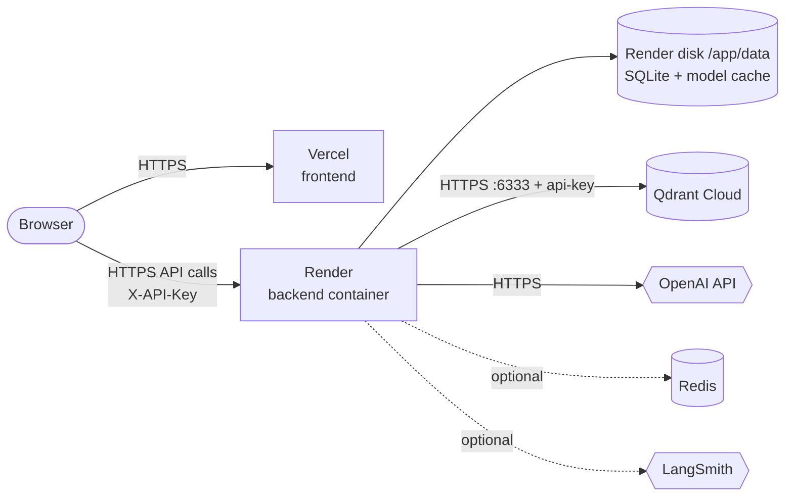

# Deployment Guide

This guide deploys the platform with managed services:

| Part | Service | What it holds |
|---|---|---|
| Vector database | **Qdrant Cloud** | All chunk vectors, chunk text and metadata (the main data) |
| Backend API | **Render** (Docker web service + 1 GB disk) | FastAPI app; SQLite metadata and the reranker model on the disk |
| Frontend | **Vercel** | Static React build |
| Cache (optional) | Render Key Value or Upstash Redis | Cached answers |
| Tracing (optional) | LangSmith | Request traces |



**Order matters:** database → backend → frontend → connect them (CORS) → verify.
Total time is about 30–45 minutes, most of it waiting for the first backend build.

---

## Step 0. Before you start

1. **Code on GitHub.** Render and Vercel deploy from your repository
   (`https://github.com/P07awan/RagPlatform`). Push any local changes first:
   ```powershell
   git push
   ```
   `backend/.env` is git-ignored, so your local keys are not uploaded. Keys go into each
   service's dashboard instead.
2. **Accounts:** [OpenAI Platform](https://platform.openai.com), [Qdrant Cloud](https://cloud.qdrant.io),
   [Render](https://render.com), [Vercel](https://vercel.com). Sign in to Render and Vercel with
   GitHub so they can see the repository.
3. **A fresh OpenAI key** for production at <https://platform.openai.com/api-keys>, with billing
   enabled. Never reuse a key that has been pasted into a chat or committed anywhere.
4. **An application API key** that protects your backend. Generate one locally:
   ```powershell
   -join ((48..57)+(65..90)+(97..122) | Get-Random -Count 40 | ForEach-Object {[char]$_})
   ```
   Save it in a password manager; you will paste it into Render and into the app's Settings page.

Keep these values in a password manager, not in a text file in the project.

---

## Step 1. Database: Qdrant Cloud

1. Go to <https://cloud.qdrant.io> and sign up.
2. Under **Create a Free Cluster**, enter a name (e.g. `rag-platform`), pick a cloud provider and
   a region close to where you will run Render (e.g. both in the US or both in the EU).
3. Click **Create Free Cluster**.
4. **Copy the API key immediately** when it is shown. It is not shown again (you can create a new
   one later from the cluster's API keys section if you lose it).
5. Open the cluster and copy its **endpoint URL**, which looks like
   `https://xyz-example.eu-central.aws.cloud.qdrant.io`. Your `QDRANT_URL` is that URL with the
   REST port added:
   ```
   QDRANT_URL=https://xyz-example.eu-central.aws.cloud.qdrant.io:6333
   QDRANT_API_KEY=<the key from step 4>
   ```
6. Test the connection from your PC (replace both values):
   ```powershell
   curl.exe -H "api-key: YOUR_QDRANT_KEY" https://YOUR-CLUSTER-URL:6333/collections
   ```
   Expected: `{"result":{"collections":[]},"status":"ok",...}`.

You do **not** need to create a collection. The backend creates `rag_documents` (1536 dimensions,
cosine distance) on first start and checks that the size matches the embedding model on every start.

> The free cluster is small but more than enough for a portfolio: the sample guide is 12 chunks,
> and a 100-page PDF is roughly 300–500 chunks of 1536 floats each.

### Other data stores

* **SQLite** (document list, ingestion status, evaluation results, chat log) lives on the Render
  disk created in Step 3. Nothing to set up.
* **Redis** is optional; see [Step 6](#step-6-optional-redis-cache).

---

## Step 2. Check the deployment files (already in the repo)

| File | Purpose |
|---|---|
| `render.yaml` | Render Blueprint: Docker web service from `backend/`, 1 CPU / 2 GB plan, 1 GB disk at `/app/data`, health check `/api/v1/health`, list of required secrets |
| `backend/Dockerfile` | CPU-only PyTorch image; binds to Render's `$PORT`; entrypoint makes the mounted disk writable then runs as a non-root user |
| `frontend/vercel.json` | Vite build to `dist/`, SPA rewrite so deep links like `/chat` work |

Why the 2 GB plan: PyTorch plus the cross-encoder reranker need several hundred MB on top of the
API itself; the smallest Render plans have 512 MB and would run out of memory. Render persistent
disks also require a paid instance. Check current prices on Render's pricing page.

---

## Step 3. Backend on Render

1. In the Render dashboard click **New → Blueprint**.
2. Connect GitHub if asked and select the **RagPlatform** repository. Render reads `render.yaml`
   and shows one web service, `rag-platform-api`, with a disk.
3. Render asks for the values marked `sync: false`. Fill them in:

   | Variable | Value |
   |---|---|
   | `OPENAI_API_KEY` | your **new** OpenAI key |
   | `API_KEY` | the application key from Step 0 |
   | `QDRANT_URL` | `https://<cluster>.cloud.qdrant.io:6333` |
   | `QDRANT_API_KEY` | Qdrant key from Step 1 |
   | `CORS_ORIGINS` | `http://localhost:5173` for now; you replace it in Step 5 |

   Already set by the blueprint: `ENVIRONMENT=production`, `DATA_DIR=/app/data`,
   `HF_HOME=/app/data/hf-cache`, `RERANKER_PRELOAD=true`, `LOG_LEVEL=INFO`.
4. Click **Apply** / **Deploy**. The first build installs PyTorch and takes several minutes.
5. Watch the **Logs** tab. A healthy start looks like:
   ```
   created qdrant collection   collection=rag_documents
   bm25 index rebuilt          chunks=0
   application started         environment=production
   reranker loaded
   ```
   If it stops with `Invalid configuration: Missing required production settings: ...`, a
   required variable is empty: fix it under **Environment** and redeploy.
6. Copy the service URL, e.g. `https://rag-platform-api.onrender.com`, and test:
   ```powershell
   Invoke-RestMethod https://rag-platform-api.onrender.com/api/v1/health
   Invoke-RestMethod https://rag-platform-api.onrender.com/api/v1/ready
   ```
   Both should report `ok` / `ready: true`. Swagger is at
   `https://rag-platform-api.onrender.com/docs`.
7. Confirm authentication works (this should return **401**):
   ```powershell
   curl.exe -i https://rag-platform-api.onrender.com/api/v1/documents
   ```

Render terminates HTTPS for you; the container itself serves plain HTTP on `$PORT`.

---

## Step 4. Frontend on Vercel

1. In Vercel click **Add New → Project** and import **RagPlatform**.
2. Set **Root Directory** to `frontend`. Vercel detects **Vite**; keep the build command
   `npm run build` and output directory `dist` (also set in `vercel.json`).
3. Under **Environment Variables** add:
   ```
   VITE_API_BASE_URL = https://ragplatform.onrender.com/api/v1
   ```
   Apply it to the **Production** (and **Preview**, if used) environments. The same value is
   committed in `frontend/.env.production` as a fallback, so a production build never points at
   `localhost`; a value set in Vercel takes precedence over that file.
   This value is compiled into the JavaScript and is public. That is fine: it is only the API
   address. Never add the OpenAI key or the application API key here.
4. Click **Deploy**, then copy the production URL, e.g. `https://rag-platform.vercel.app`.

If you change `VITE_API_BASE_URL` later you must **redeploy** the frontend, because the value is
baked in at build time.

---

## Step 5. Connect frontend and backend (CORS)

The backend only accepts browser requests from origins listed in `CORS_ORIGINS`.

1. In Render → `rag-platform-api` → **Environment**, set:
   ```
   CORS_ORIGINS=https://rag-platform.vercel.app
   ```
   Use the exact origin: `https://`, the host, no path, **no trailing slash**. To allow several,
   separate with commas, e.g. `https://rag-platform.vercel.app,https://www.yourdomain.com`.
   Wildcards (`*`) are rejected on purpose.
2. Save; Render restarts the service.

Vercel **preview** deployments get different URLs and will be blocked unless you add them too.
Use the production URL for normal use.

---

## Step 6. Optional: Redis cache

Repeated questions are then answered from the cache without OpenAI calls. Skip this if you do not
need it; the app works fully without Redis.

**Render Key Value** (same provider, private network):
1. **New → Key Value**, same region as the backend.
2. Copy its **internal** connection URL (`redis://red-xxxx:6379`).
3. In the backend's Environment add `REDIS_URL=<that URL>` and `ENABLE_CACHE=true`.

**Upstash** (free tier): create a database and use its `rediss://` URL (TLS) as `REDIS_URL`.

If Redis becomes unreachable the backend keeps working without the cache and logs a warning.

## Step 7. Optional: LangSmith tracing

1. Create an API key at <https://smith.langchain.com> (Settings → API Keys).
2. Add to the backend environment:
   ```
   LANGSMITH_TRACING=true
   LANGSMITH_API_KEY=lsv2_...
   LANGSMITH_PROJECT=production-rag-platform
   LANGSMITH_HIDE_CONTENT=true   # recommended: keep document text and questions out of traces
   ```
3. Ask a question in the app, then open the project in LangSmith to see the `rag_chat_stream`
   run with one span per pipeline step.

---

## Step 8. Verify the deployment

1. Open the Vercel URL. The sidebar should show **Backend healthy**.
2. Go to **Settings**, paste the application API key, click **Save key**. The key is stored only in
   this browser. The configuration card should show your models, `production`, and
   **OpenAI key: configured**.
3. **Documents:** upload `backend/evaluations/sample_corpus/platform_guide.md`; it should reach
   `indexed` within a few seconds.
4. **Chat:** ask "What is the default chunk size?". The answer should stream in with a `[1]`
   citation and sources in the side panel.
5. Run the automated end-to-end check from your PC against production (it uploads a copy of the
   sample guide, asks questions, then deletes its copy):
   ```powershell
   cd backend
   .\.venv\Scripts\python scripts\smoke_test.py --base-url https://rag-platform-api.onrender.com/api/v1 --api-key YOUR_APP_KEY
   ```
   Expect `0 failure(s)`.
6. Optional: **Evaluations → Run evaluation** with a case limit of 5. Each case makes about 10
   OpenAI calls.

---

## Day-to-day operations

* **Deploying changes:** `git push` to `main`. Render redeploys when files under `backend/` change;
  Vercel redeploys on every push.
* **Logs:** Render → service → Logs (JSON lines with `request_id`); Vercel → project → Logs.
* **Rotating keys:** change the variable in the dashboard and redeploy/restart. For `API_KEY`, also
  update it on the app's Settings page.
* **Changing the embedding model:** the backend refuses to start serving queries on a collection
  with the wrong vector size. Re-embed into a new collection with `scripts/reindex.py` (run it
  locally with `QDRANT_URL`/`QDRANT_API_KEY` pointing at Qdrant Cloud and the new model set), then
  set `QDRANT_COLLECTION_NAME` to the new collection on Render.
* **Backups:** vectors live in Qdrant Cloud (see its snapshot options). The Render disk holds only
  metadata; if it is lost, the vectors stay searchable but the document list and evaluation
  history are empty.
* **Scaling:** keep **one instance** with one worker. The BM25 keyword index and background jobs
  live in process memory, and Render cannot scale a service that has a disk.

---

## Troubleshooting

| Symptom | Cause and fix |
|---|---|
| Render deploy fails during `pip install` | Usually a transient network error; click **Manual Deploy → Clear build cache & deploy** |
| Service restarts, logs mention memory | Plan too small; use at least 2 GB RAM |
| `Invalid configuration: Missing required production settings` | `OPENAI_API_KEY` or `API_KEY` empty in Render Environment |
| `Invalid configuration: QDRANT_PATH ... not supported in production` | Remove `QDRANT_PATH` from Render; production must use `QDRANT_URL` |
| `/ready` 503, qdrant `down` | Wrong `QDRANT_URL` (include `https://` and `:6333`) or wrong `QDRANT_API_KEY` |
| `vector_dimension_mismatch` | Collection created with a different embedding model; reindex or use a new collection name |
| Browser console: "blocked by CORS policy" | `CORS_ORIGINS` does not exactly match the Vercel URL (scheme, host, no trailing slash) |
| UI shows 401 / "Invalid API key" | Paste the same `API_KEY` on the Settings page |
| UI calls `localhost:8000` in production | `VITE_API_BASE_URL` not set on Vercel, or set after the build; redeploy |
| Refreshing `/chat` on Vercel gives 404 | Root Directory is not `frontend`, so `vercel.json` was not used |
| `upstream_quota_exceeded` | Add billing/credits to the OpenAI project |
| First answer after deploy is slow | Reranker still loading; `RERANKER_PRELOAD=true` loads it during startup |

---

## Production checklist

- [ ] New OpenAI key, created only for this deployment, with a spending limit set in OpenAI
- [ ] `API_KEY` set (long and random) and `ENVIRONMENT=production`
- [ ] `CORS_ORIGINS` contains only your real frontend origin(s)
- [ ] Qdrant Cloud key stored only in Render
- [ ] No `.env` files committed (`git ls-files | Select-String "\.env$"` shows nothing)
- [ ] `/api/v1/ready` returns 200 and the smoke test passes
- [ ] You understand this is a **single-user** setup: anyone with the application key has full
      access. Multi-user use needs real login and per-user document access (see README).

## Alternative: one server with Docker Compose

If you prefer a single VPS (any Linux host with Docker), you can run everything including Qdrant
yourself:

```bash
git clone https://github.com/P07awan/RagPlatform.git && cd RagPlatform
cp backend/.env.example backend/.env    # set OPENAI_API_KEY, API_KEY, ENVIRONMENT=production
VITE_API_BASE_URL=https://api.yourdomain.com/api/v1 \
CORS_ORIGINS=https://app.yourdomain.com \
docker compose up -d --build
```

Compose binds ports to `127.0.0.1` only, so put a reverse proxy with HTTPS in front (for example
Caddy or nginx with Let's Encrypt) that forwards `api.yourdomain.com` to port 8000 and
`app.yourdomain.com` to port 8080. Qdrant data is kept in the `qdrant_data` Docker volume; back it
up regularly.
